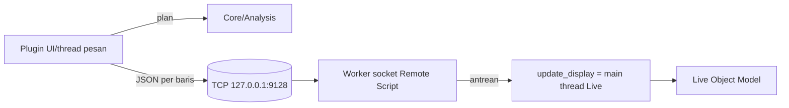

# Arsitektur Seq Analyzer VST (ringkas, M0)

Status: usulan Architect (BSKR-26). Kontrak terperinci: `docs/adr/0001-bridge-protocol-m0.md`.

## 4 lapisan

1. **Plugin JUCE (VST3/AU) — `plugin/`**: UI (daftar lagu, ANALYZE/REVIEW/BUILD, status koneksi), memuat audio. Tidak menyentuh LOM.
2. **Sequencer Core / Analysis — `engine/`**: deteksi BPM, downbeat, section; menghasilkan Build Plan tervalidasi (`plan.schema.json` — belum ada, dikunci sebelum M1).
3. **Bridge localhost**: JSON-per-baris TCP `127.0.0.1:9128`; envelope `v/id/action/params`, error code stabil, handshake `ping`.
4. **Ableton adapter — `remote/SeqAnalyzer_Remote`**: Remote Script Python; satu-satunya yang membaca/menulis LOM.

## Threading
- **Live**: LOM hanya boleh diakses dari main thread. Worker socket hanya parse/validasi bentuk, memasukkan request ke antrean (maks 8) dan menunggu; `update_display` mengeksekusi (maks 2 request per tick) dan membalas. Timeout main thread 15 dtk → `TIMEOUT_MAIN_THREAD`. Satu request aktif pada satu waktu.
- **Plugin**: tidak ada I/O socket atau analisis di audio callback. Klien bridge berjalan di thread terpisah (bukan thread pesan UI untuk operasi blocking); hasil dikirim ke UI lewat message queue. `build_one` tidak di-retry otomatis.

## Keamanan localhost
Bind hanya loopback, allow-list aksi, batas ukuran baris, tanpa eksekusi kode/UI automation. Tanpa autentikasi di M0 (risiko diterima, hardening berupa token → opsi M1; lihat ADR §2.4).

## Terbukti vs belum
- **Terbukti**: logika plan/validasi warp terhadap fake clip (`test/test_warp_build.py`).
- **Teramati di eksperimen (bukan produk)**: Warp marker via Python, `loop_end`/`end_marker`, reopen — Live 12.3.2 macOS (Eksperimen 10B–14).
- **Belum**: bridge end-to-end (beta.1 `ECONNREFUSED` karena script tak terpasang); persistensi setelah reopen lewat Remote Script; pembuatan clip SECTIONS/GUIDE CUES dari Python; tempo pre-roll 8 bar (jeda antar lagu kembali ke 120 BPM); baca/set status Lead (tidak ada API → manual); warp builder baru mendukung BPM stabil, tanpa trim, downbeat di detik 0, tepat 2 marker.

Gate G0 = BUILD 1 lagu dari Remote Script dan benar setelah Set dibuka ulang, diverifikasi dengan `read_clip_state`. Detail alternatif jika gagal: ADR 0001 §7.
